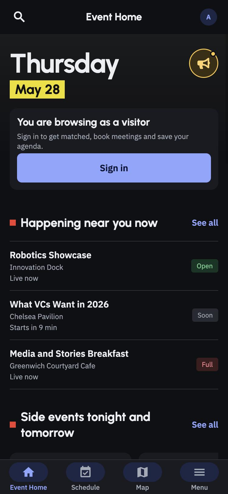
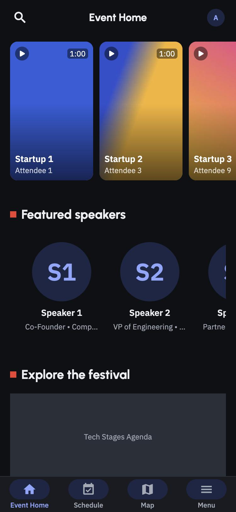
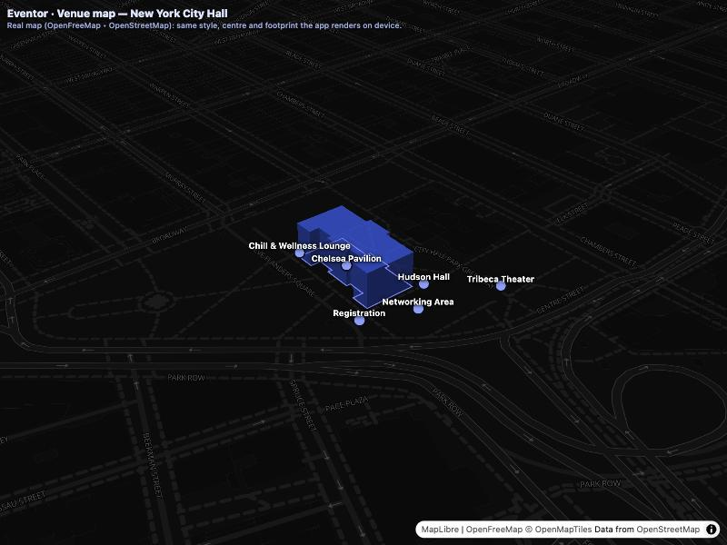

<div align="center">


# Eventor

**Open-source mobile event companion app, built with Expo, React Native and TypeScript.**

Schedule · Venue map · Attendee networking · QR check-in · AI assistant

[](LICENSE)
[](https://expo.dev)
[](https://reactnative.dev)
[](https://www.typescriptlang.org)

[](#contributing)

</div>

Eventor gives attendees a schedule, a venue map, an attendee directory with interest matching and 1:1 meetings, QR check-in, and an optional AI assistant that answers questions from the event's own facts. It ships with dummy data set in New York City, so you can run it today and swap in your own event.

## Screenshots

<div align="center">
<table>
<tr>
<td align="center" width="50%">
<br/>
<sub><b>Event home</b><br/>Happening now and up next</sub>
</td>
<td align="center" width="50%">
<br/>
<sub><b>Speakers and reels</b><br/>Featured people and short clips</sub>
</td>
</tr>
</table>

<br/>
<sub><b>Venue map</b> · real MapLibre street map (OpenFreeMap tiles, OpenStreetMap data)</sub>

</div>

> Demo data is generic on purpose (Speaker 1, Startup 1, and so on). Replace everything in `src/data` with your own event.

## Features

- Event home with "happening now / up next" and a countdown
- Multi-day schedule with filters, a personal agenda and live session status
- Venue map (MapLibre) with place sheets, walking routes and QR checkpoints
- Attendee networking: directory, interest matching, 1:1 meetings, chat
- QR check-in, a collectible event passport and a leaderboard
- Side events, tickets, speaker profiles and short reels
- Optional AI assistant grounded only on the event's facts
- Light and dark themes, offline demo mode, accessibility support

The full list is in [docs/FEATURES.md](docs/FEATURES.md). Why it matters for networking: [docs/IMPACT.md](docs/IMPACT.md).

## Tech stack

| Layer | Choice |
| --- | --- |
| App | [Expo](https://expo.dev) + [React Native](https://reactnative.dev) |
| Language | [TypeScript](https://www.typescriptlang.org) |
| Navigation | [Expo Router](https://docs.expo.dev/router/introduction/) (file-based) |
| Maps | [MapLibre](https://maplibre.org) + OpenFreeMap tiles |
| Package manager | [pnpm](https://pnpm.io) |
| Tests | [Jest](https://jestjs.io) |

## Brand palette

The app theme is driven by design tokens in `src/constants/theme.ts`. The core colors:

| Token | Color | Use |
| --- | --- | --- |
| Primary | `#2648D1` | actions, links, brand |
| Primary pressed | `#1D39AB` | pressed state |
| Primary soft | `#E7ECFD` | tints and chips |
| Accent | `#FFC53D` | highlights, dates |
| Accent soft | `#FFF3CC` | accent tints |
| Success | `#1B7A3D` | live / open seats |
| Warning | `#8A6100` | filling up |
| Danger | `#C42634` | full / errors |
| Ink | `#141922` | primary text |
| Muted | `#5B6472` | secondary text |
| Surface | `#F5F6F8` | app background (light) |

## Quick start

```sh
pnpm install
./run.sh            # or: npx expo start
```

`run.sh` installs dependencies if needed and starts Expo. Options:

```sh
./run.sh --tunnel   # reach the dev server from a phone on another network
./run.sh --web      # open the web build
```

## Run on your phone

1. Start the dev server (`./run.sh`).
2. Install Expo Go on your phone and scan the QR code shown in the terminal.
3. Some features use native modules (the map and the camera/QR scanner). Expo Go may not include everything, so for the full app build a development build:

```sh
npx expo run:ios      # or: npx expo run:android
```

Use `./run.sh --tunnel` if your phone and computer are not on the same network.

## Configuration

```sh
cp .env.example .env.local
```

Everything is optional. To enable the AI assistant, set the URL of your assistant backend:

```sh
EXPO_PUBLIC_ASSISTANT_URL=https://your-assistant-host.example.com
```

If it is unset, the app works normally and the chat shows "not connected". Never commit `.env.local` or any API key. See [docs/SERVER.md](docs/SERVER.md) for the backend.

## Make it your own

1. Replace the demo data in `src/data` (schedule, speakers, people, venues, partners).
2. Swap the brand assets in `assets/brand` (icon, splash, wordmark).
3. Adjust colors in `src/constants/theme.ts`.
4. Point the map at your venue in `src/lib/geo.ts`.

## Documentation

- [docs/FEATURES.md](docs/FEATURES.md) · full feature list
- [docs/IMPACT.md](docs/IMPACT.md) · why it helps networking
- [docs/SERVER.md](docs/SERVER.md) · the optional assistant backend
- [docs/BUILD-AND-TOKENS.md](docs/BUILD-AND-TOKENS.md) · builds and design tokens
- [AGENTS.md](AGENTS.md) · for AI agents and contributors

## Contributing

Issues and pull requests are welcome. Please run the checks before opening a PR:

```sh
npx tsc --noEmit      # types
npx expo lint         # lint
pnpm test             # unit tests
```

## License

MIT. See [LICENSE](LICENSE).

## Keywords

event app, conference app, event management, attendee networking, event networking app, React Native, Expo, Expo Router, TypeScript, MapLibre, QR check-in, event schedule, event agenda, venue map, AI event assistant, attendee matching, mobile app template, open source
